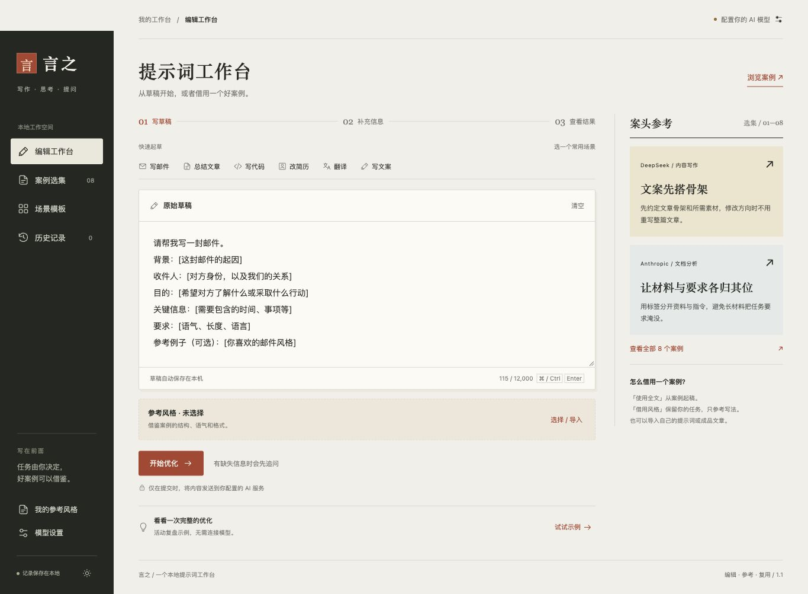

# 言之 · 提示词优化工具

把没说出口的信息补齐，再把想法写清楚。言之是一个帮普通人把需求说清楚的开源提示词工具：**先追问，再优化，再解释**。提供两种用法：

| 用法 | 适合谁 | 需要什么 |
| --- | --- | --- |
| 网页工作台 | 喜欢可视化编辑、案例选集、风格导入与历史记录 | 浏览器；真实优化需要自己配置兼容 API |
| Agent Skill | 想在现有 agent 对话中直接优化提示词 | 支持 `SKILL.md` 的 agent；无需额外 API Key |

Skill 使用当前 agent 的能力和正常用量，不代表模型免费。网页演示无需 Key，但演示不生成真实 AI 结果。



## 作为 Skill 使用

Skill 入口：[`skills/yanzhi-prompt-optimizer/SKILL.md`](skills/yanzhi-prompt-optimizer/SKILL.md)。整个文件夹独立可用，包含 8 个可按需读取的教学案例；不依赖网页、不运行脚本、不读取凭据。

1. 从 GitHub 的 **Code → Download ZIP** 下载并解压项目，或使用发布的 Skill ZIP。
2. 将整个 `yanzhi-prompt-optimizer` 技能文件夹复制到你的 agent 技能目录。Codex 当前的个人技能目录为 `~/.agents/skills/`，也可放在某个项目的 `.agents/skills/` 下。不要覆盖已有同名目录；其他支持 SKILL.md 的 agent 使用各自的技能安装入口。目录规则参考 [Codex 官方说明](https://learn.chatgpt.com/docs/customization/overview#skills)。
3. 确认最终路径类似 `~/.agents/skills/yanzhi-prompt-optimizer/SKILL.md`，而不是多嵌套一层仓库目录。重新打开对话；若客户端没有发现新技能，按其要求刷新或重启。
4. 在 Codex 对话中输入：

```text
请用 $yanzhi-prompt-optimizer 优化这个提示词：
帮我给领导写一份上周活动复盘。
```

借鉴参考的调用示例：

```text
请用 $yanzhi-prompt-optimizer 优化：帮我写一份产品更新通知。
这是我喜欢的成品文章：[粘贴一小段]
只借鉴语气和格式，不沿用里面的产品功能或数据。
```

也可以提供提示词范例，借鉴其组织方式。Skill 会先判断是否缺少关键信息，必要时最多追问一轮，再给可复制的提示词和 2–4 条改动解释。普通对话输出自然文本，不强制网页使用的 JSON。

若 agent 没有技能安装功能，可将 `SKILL.md` 正文作为本次对话的工作说明；引用案例时还需提供 `references/cases.md`。本项目未在所有 agent 产品上逐一验证兼容性。

## 打开使用

直接双击 `index.html`，用现代浏览器打开即可。无需安装依赖、构建或注册账号，全部页面代码在这一个文件里。

1. 点击「试试示例」，无需 Key 即可体验活动复盘的追问与结果。演示使用本地固定逻辑，会明确标注，不调用 AI，也不保存到历史。
2. 要优化自己的内容，点击右上角「配置你的 AI 模型」。填写服务商的 **API 地址、API Key、模型名称**。
3. 输入原始提示词，或选择一个场景模板并替换方括号内容。
4. 点击「开始优化」。信息足够时直接生成结果，否则最多追问 3 个问题。可以选答案、自由填写或留空。
5. 生成后查看原版与优化版、改动说明，点击「复制」。真实调用的结果自动保留最近 20 条，可在历史页查看或删除。

模型和 API 地址没有预设，以免将内容发送到不是你想用的服务。页面显示模型名称表示**已经配置**，不代表已经成功验证连接。

如果浏览器对 `file://` 的存储或网络请求有限制，可以使用本机服务器：

```bash
cd "项目所在目录"
python3 -m http.server 8765 --bind 127.0.0.1
```

然后访问 <http://127.0.0.1:8765>。Windows 可将 `python3` 换为 `py`。终端按 `Ctrl+C` 关闭服务器。固定使用同一个访问方式和端口，本地数据才处于同一个浏览器存储空间。移动或重命名单文件可能导致原来的 `file://` 存储不可见。

## 已实现

- 最多一轮、1–3 个关键追问，每题 2–3 个选项，并支持补充自由文本。
- 信息足够时跳过追问；未回答内容保留必要的待补充项。
- 原始/优化提示词对比，2–4 条改动解释，复制与重新编辑。
- 六个填空模板：邮件、总结、代码、简历、翻译、文案。
- 最近 20 条本地历史，单条删除与清空确认。
- 自定义 OpenAI Chat Completions 兼容接口、可选 JSON 模式。
- 加载状态、防止重复请求、主动取消、90 秒超时、失败后原步骤重试。
- 非法 JSON、结构异常、空回复与截断回复的原文兜底。
- 草稿自动保存，浅色/深色主题，手机布局与键盘操作。
- 无依赖、无 CDN、无分析追踪；演示无需网络。
- 8 个国内外案例：筛选、搜索、来源拆解、全文起稿、借用风格。
- 两种参考类型：提示词写法 / 成品文章风格；结构、语气、格式可分别勾选。
- 粘贴或导入 TXT、Markdown、JSON；最多保存 20 条风格，历史保留当次参考快照。

## 案例与风格怎么用

页面采用纸色背景、炭黑侧栏和朱红色按钮。侧栏的「案例选集」收录 8 个案例；每个都有全文、适用场景、写法拆解和来源链接，支持国内 / 国外筛选与搜索。

- **使用全文起稿**：用案例正文作为新的草稿，已有内容时会先提示确认。
- **借用这个风格**：保留当前任务，把案例作为参考材料随优化请求发送。默认参考结构、语气和格式，可以在「选择 / 导入」中调整。
- **提示词范例**：借鉴指令本身的写法，例如分区、步骤、约束和输出要求。
- **成品文章**：借鉴最终文章的语气、组织方式和格式，把这些特征转成优化提示词中的要求。

从「选择 / 导入」或「我的参考风格」进入，可粘贴范例，或选择 UTF-8 编码的 `.txt`、`.md`、`.json` 文件。正文限制 10–6,000 个字符，文件上限 64,000 字节。TXT / Markdown 默认识别为提示词，载入后可改为成品文章。文件先载入供检查，点击「保存并应用」才生效；这两步不调用 AI。

JSON 为单个对象，例如：

```json
{
  "name": "清楚克制的说明",
  "kind": "output",
  "aspects": ["tone", "format"],
  "content": "现在，你可以把常用的筛选条件保存下来。下次打开列表，选一下就能继续工作。"
}
```

`kind` 可选 `prompt`（提示词）或 `output`（成品文章）；`aspects` 可选 `structure`（结构）、`tone`（语气）、`format`（格式），至少一项。省略这两个字段时默认为提示词、参考全部三项。可直接使用项目中的 [成品文章 JSON 示例](examples/style-output.json) 或 [提示词 Markdown 示例](examples/style-prompt.md)。

当前参考会自动保存，刷新后恢复。「移除」只取消本次使用，已保存的风格仍可从导入面板载入；库中最多 20 条，满额时需自行移除。优化进行中不能更换参考，追问后更换会返回草稿重新开始。历史记录展示的是当次参考，之后编辑风格不会改变旧记录。

原始任务优先：参考中的事实、人物、数字和目标不应搬到当前任务，参考中的指令不能覆盖优化规则。这些要求会写入模型请求；模型实际遵循程度仍需结合真实输出判断。**「试试示例」是固定本地演示，不应用参考风格，也不能用来评估风格效果。**

### 案例来源与署名

所有收录的中文提示词均为言之根据公开方法或场景编写的教学案例，**非官方原文或官方中文翻译**，不宣称官方背书或经过模型效果评测。查阅日期：2026-10-22。

| 来源 | 参考方法 / 场景 | 对应案例 |
| --- | --- | --- |
| [DeepSeek 提示库](https://api-docs.deepseek.com/zh-cn/prompt-library/) | 文案大纲、宣传标语、中英翻译场景 | 01–03 |
| [LangGPT 结构化提示词指南](https://github.com/langgptai/LangGPT/blob/main/Docs/HowToWritestructuredPrompts.md)，作者云中江树 | 分区组织、约束、工作步骤 | 04 |
| [Anthropic 提示词最佳实践](https://platform.claude.com/docs/en/build-with-claude/prompt-engineering/claude-prompting-best-practices) | XML 标签、长文档先提取依据 | 05–06 |
| [Google Gemini 提示策略](https://ai.google.dev/gemini-api/docs/prompting-strategies?hl=en) | 用示例明确输出边界与一致格式 | 07–08 |

## API 地址怎么填

使用服务商文档里的兼容接口 Base URL，并保留服务商要求的路径。例如 `https://你的服务商/v1`，页面会追加 `/chat/completions`。也可以直接填写完整的 `/chat/completions` 地址，不会重复追加。

不同服务商的版本路径、模型 ID、CORS 政策和 JSON 模式支持程度不同，需要以所选服务商文档为准。这里实现的是 Chat Completions 兼容协议，不能把 Responses 或 Anthropic Messages 的原生接口地址直接填入。

请求格式：

```json
{
  "model": "你填写的模型名称",
  "messages": [
    { "role": "system", "content": "内置优化助手规则与 JSON 输出约定" },
    { "role": "user", "content": "原始提示词及任务描述" }
  ],
  "stream": false
}
```

Key 通过 `Authorization: Bearer …` 发送；本机免鉴权服务允许不填 Key。开启 JSON 模式后增加 `response_format: {"type":"json_object"}`，默认关闭以便兼容更多服务商。即使开启 JSON 模式，也会验证问题数量、字段类型和改动说明数量；合法 JSON 不等于符合业务结构。相关格式原则参考 [OpenAI 官方 JSON 模式说明](https://developers.openai.com/api/docs/guides/structured-outputs#json-mode)。

## 代码在哪里修改

`index.html` 按中文注释分区：

| 位置 | 负责什么 | 常见修改 |
| --- | --- | --- |
| `:root` 与 `<style>` | 主题、间距、布局与断点 | 改品牌颜色、字体、手机排版 |
| HTML 主体 | 侧栏、输入、追问、结果、设置对话框 | 改文案和页面结构 |
| `SYSTEM_PROMPT` | 优化助手的判断规则与输出格式 | 调整追问策略和解释方式 |
| `TEMPLATES` / `CASES` | 场景模板与案例及来源 | 增加案例、修改填空内容 |
| `STYLE_RULES` / `normalizeStyle` / `parseStyleImport` | 两种风格规则、校验与文件解析 | 调整参考方式、支持新导入格式 |
| `renderGallery` / `activateStyle` / `renderSavedStyles` | 案例筛选、应用与风格库 | 扩展案例与风格交互 |
| `normalizeEndpoint` / `validateSettings` | 接口配置校验 | 适配地址规则 |
| `buildMessages` / `buildRequest` / `requestAI` | 请求体、对话与网络调用 | 扩展新的接口协议 |
| `parseReply` | AI 结果校验 | 扩展 JSON 结构时同步修改 |
| `readStorage` / `writeStorage` / `cleanHistory` | 本地设置、草稿、历史 | 改保存策略与记录上限 |
| `begin` / `finishQuestions` / `runAttempt` | 请求、状态、取消与重试 | 调整优化流程 |
| `renderQuestions` / `showResult` / `renderHistory` | 结果与历史渲染 | 扩展展示内容 |
| 最后一段事件绑定 | 按钮、快捷键、设置与初始化 | 增加交互入口 |

诊断打分、A/B 实际输出比较、反向生成、带变量替换的提示词库和多模型专门适配尚未加入。当前风格库用于参考写法，不执行变量替换。现有左右对比只比较提示词文字，不会额外调用模型执行两份提示词。

## 本地数据与 Key

- 设置、历史、草稿、风格库、当前参考和主题使用浏览器 `localStorage`，不同浏览器/设备/站点地址不共享数据。
- 默认可记住 Key；它是浏览器明文存储，不是加密保险箱。取消「记住 API Key」后只保留在当前页面内存，刷新后需重新填写。
- 关闭设置对话框时清空隐藏表单里的 Key；Key 不写入项目代码、历史记录或日志。
- 点击「移除已保存的 Key」可删除保存的 Key。浏览器不允许存储时，界面会提示仅在当前页面有效。
- 提交时原始内容、所选参考范例和 Key 直接发到你配置的服务商地址。除服务商以外，本工具不向其他服务器上传或同步。
- 本版本用于个人本地使用。对外提供统一 Key 的服务，需要增加后端并把 Key 保存在后端，不能把自己的 Key 写进 HTML。

## 常见问题

| 现象 | 处理 |
| --- | --- |
| 401 | 检查 Key 是否正确、过期或被撤销 |
| 403 | 检查模型权限、服务区域和访问来源限制 |
| 404 | 核对版本路径、完整端点、模型名称 |
| 400 | 核对模型，尝试关闭 JSON 模式 |
| 429 | 等待后重试，并检查额度/限流 |
| 网络错误 | 检查地址、网络和证书；也可能是 CORS 或重定向被阻止 |
| 格式异常 | 原始回复会保留；重试或换用更遵循 JSON 指令的模型 |
| 超时 | 90 秒自动停止等待，可重试或更换模型 |

本机静态服务器只改变页面打开方式，**不会解决服务商的 CORS 限制**。不支持浏览器直连的服务需要可信后端代理，本项目没有附带代理。不要将真实 Key 交给不明公共代理。

## 验证

测试使用 Node.js 内置测试框架，不需要 npm 安装：

```bash
node --test tests/core.test.cjs
```

覆盖接口地址和设置校验、结构异常、追问轮次、空白回答、模拟两轮请求、HTTP 错误、截断/拒绝、取消、历史裁剪和凭据隔离，以及导入格式校验、两种参考类型、两轮参考传递、风格库去重和历史快照等，共 27 项。测试使用假 Key 和本地替身响应，不请求真实服务商，也不产生模型费用。

浏览器操作可用「试试示例」检查完整交互；真实模型质量、所选服务商的 CORS 和权限需要用户填入自己的配置后验证。

## 分享与开发

- 独立测试说明：[docs/TESTING.md](docs/TESTING.md)。
- 贡献说明：[CONTRIBUTING.md](CONTRIBUTING.md)。
- 构建不含凭据与本地交接记录的分享包：`python3 scripts/package.py`。输出到 `dist/`，其中 `yanzhi-prompt-optimizer-skill.zip` 只含 Skill 与许可证，`yanzhi-project.zip` 包含网页、Skill、说明与测试。

## 许可证

本项目原创代码、Skill 与教学示例采用 [MIT License](LICENSE)。参考资料的商标、文档和其他第三方内容仍属于各自权利人；来源链接不表示本项目获得官方背书，也不会改变第三方资料的许可。
